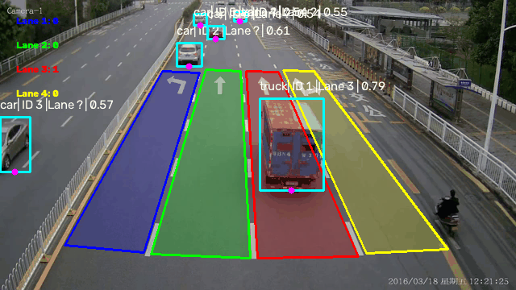
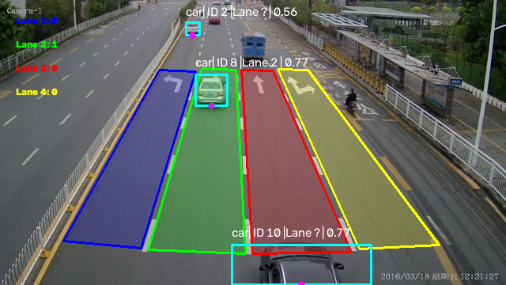

# Vehicle Detection, Tracking, and Lane Analysis

A computer vision project for detecting, tracking, and analyzing vehicles across multiple traffic lanes.

The project uses YOLO for vehicle detection, ByteTrack for multi-object tracking, and OpenCV for lane analysis and visualization.

## Demo



### Example Output



## Features

- Detect cars, buses, and trucks using YOLO
- Track vehicles across consecutive frames using ByteTrack
- Assign a persistent track ID to each detected vehicle
- Define four traffic lanes using polygon regions
- Calculate the bottom-center point of each bounding box
- Determine which lane contains each vehicle
- Count the number of vehicles currently present in each lane
- Display:
  - Bounding boxes
  - Vehicle classes
  - Confidence scores
  - Track IDs
  - Lane IDs
  - Per-lane vehicle counts
- Visualize the results in real time with OpenCV

## Technologies

- Python
- Ultralytics YOLO
- ByteTrack
- OpenCV
- NumPy

## Project Structure

```text
object-detection-tracking-yolo-basic/
├── assets/
│   ├── demo.gif
│   └── output.png
├── inputs/
│   └── videos/
│       └── autobahn.mp4
├── models/
│   └── yolo26n.pt
├── src/
│   ├── config.py
│   ├── detector.py
│   ├── lane_manager.py
│   ├── main.py
│   └── visualizer.py
├── .gitignore
├── README.md
└── requirements.txt
```

The model weights and input video are excluded from the repository.

## Processing Pipeline

The application processes every video frame using the following pipeline:

```text
Input Video
    ↓
YOLO Vehicle Detection
    ↓
ByteTrack Object Tracking
    ↓
Bottom-Center Point Calculation
    ↓
Lane Assignment
    ↓
Per-Lane Vehicle Counting
    ↓
OpenCV Visualization
```

## Installation

### 1. Clone the repository

```bash
git clone <repository-url>
cd object-detection-tracking-yolo-basic
```

Replace `<repository-url>` with the URL of this GitHub repository.

### 2. Create a virtual environment

```bash
python -m venv .venv
```

Activate the environment on Windows:

```bash
.venv\Scripts\activate
```

Activate the environment on Linux or macOS:

```bash
source .venv/bin/activate
```

### 3. Install dependencies

```bash
pip install -r requirements.txt
```

## Model and Video Setup

The YOLO model weights and input video are not included in this repository.

Create the required directories if they do not exist:

```text
inputs/videos/
models/
```

Place the YOLO model at:

```text
models/yolo26n.pt
```

Place the input video at:

```text
inputs/videos/autobahn.mp4
```

If you use different filenames or paths, update them in:

```text
src/config.py
```

## Configuration

The main configuration values are located in `src/config.py`.

```python
VIDEO_PATH = PARENT_DIR / "inputs" / "videos" / "autobahn.mp4"
MODEL_PATH = PARENT_DIR / "models" / "yolo26n.pt"

CONF_THRESHOLD = 0.5

VEHICLE_CLASSES = [
    2,  # car
    5,  # bus
    7,  # truck
]
```

You can adjust:

- Input video path
- YOLO model path
- Confidence threshold
- Vehicle classes

## Usage

Run the application from the project root:

```bash
python src/main.py
```

Press `Esc` to stop playback and close the OpenCV window.

## How Lane Assignment Works

Each detection has a bounding box:

```text
(x1, y1, x2, y2)
```

The application calculates the bottom-center point:

```text
anchor_x = (x1 + x2) / 2
anchor_y = y2
```

OpenCV then checks whether this anchor point lies inside one of the lane polygons using:

```python
cv2.pointPolygonTest()
```

If the point lies inside a polygon, the corresponding lane ID is assigned to the vehicle.

## Current Vehicle Counting

The current counter represents the number of detected vehicles present in each lane for the current frame.

Example:

```text
Lane 1: 0
Lane 2: 2
Lane 3: 1
Lane 4: 0
```

The counter is reset and recalculated for every frame. It does not yet represent the total number of vehicles that have passed through the scene.

## Notes

- The current lane polygons are configured for a video resolution of `640 × 360`.
- Polygon coordinates are specific to the current camera perspective.
- Different videos may require new polygon coordinates.
- Detection quality depends on the selected YOLO model and confidence threshold.
- The model weights and video files are ignored by Git because they are binary input assets.

## Future Improvements

- Add counting lines for total vehicle counting
- Count unique vehicles using track IDs
- Estimate vehicle speed
- Detect speeding vehicles
- Save annotated output videos
- Add command-line arguments for video and model paths
- Support different camera resolutions
- Add automated tests